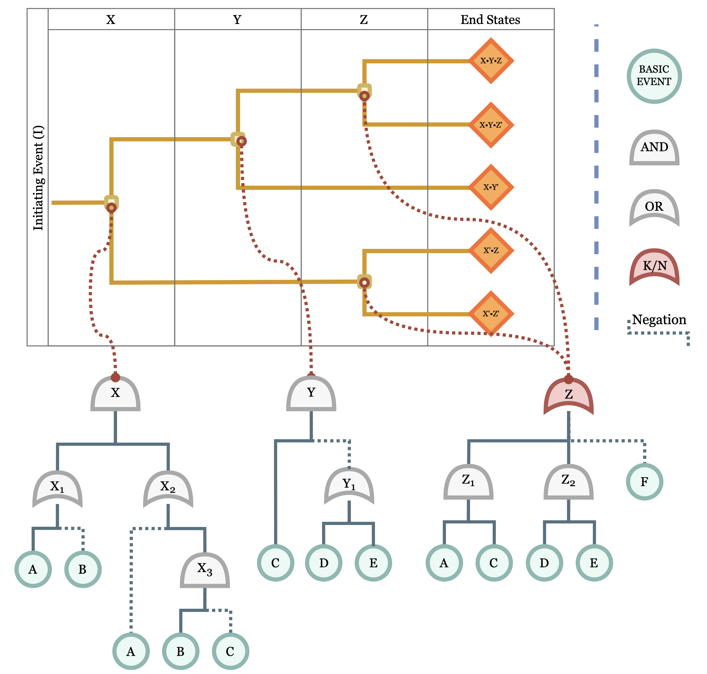
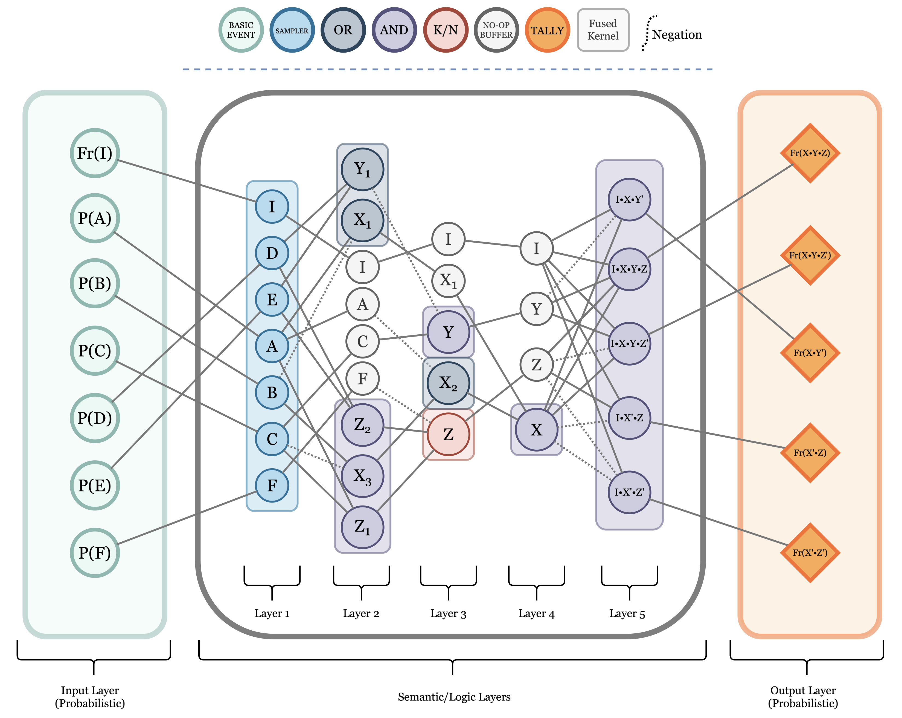

fuzzybits
=========

fuzzybits estimates the probability of a fault-tree top event in an
OpenPSA MEF model by Monte Carlo. It compiles the model's logic once
into a Boolean circuit, packs 64 independent trials into each 64-bit
word, evaluates the gates with bitwise instructions on a CPU or an
NVIDIA GPU, and reports the estimate with a 95% confidence interval.
No cut sets are generated and nothing is truncated or bounded. The
cost is that, for a fixed relative error, the number of trials grows
as 1/p.

Status: alpha (0.18.4). Each compile produces one query: the top gate
of the first fault tree, or the gate named with --target. Event-tree
sequences and end states are not compiled yet
([#92](https://github.com/fuzzybit-org/fuzzybits/issues/92)).

When to use it, and when not
----------------------------

If a BDD, or a cut-set tool with an upper bound, finishes on your
model, use it: the answer is exact or bounded, and on most published
fault trees it is fast. fuzzybits is for models where those methods
run out of memory or time, or where you want the only error in the
answer to be a stated sampling error rather than an unreported
truncation error.

Example: nus9601 from the Aralia set (1,567 basic events, exact
p = 9.94e-6). SCRAM's BDD and ZBDD run out of memory on it, and the
exact value took 2.5 hours with ganak. fuzzybits runs 1e8 trials,
gets 965 hits and estimates 9.59e-6 +/- 6% (95%) in about 0.6 s on a
Tesla V100S or 12 s on an 8-core i7-9700 (sampling time, start-up
excluded). The ganak time comes from a different machine, so treat
the comparison as indicative.

It is not the right tool, yet, for very rare events. For a fixed
relative error the number of trials grows as 1/p (see How many
trials): p = 1e-8 to +/- 10% needs about 4e10 trials, and four Aralia
models with p between 1.4e-8 and 1.1e-13 are infeasible at the
1e8-trial cap (see Accuracy). Exact module collapse and importance
sampling are planned, not done
([#21](https://github.com/fuzzybit-org/fuzzybits/issues/21),
[#6](https://github.com/fuzzybit-org/fuzzybits/issues/6)).

Install
-------

    pip install fuzzybits fuzzybits-server

Wheels are built for CPython 3.12 to 3.15 on Linux x86_64 (glibc 2.39
or newer, for example Ubuntu 24.04), macOS 15+ on Intel and macOS 26+
on Apple Silicon. On Linux, an NVIDIA GPU needs only the driver (CUDA
12.8 or newer). On macOS, sampling runs on the CPU; the Metal backend
is experimental ([#30](https://github.com/fuzzybit-org/fuzzybits/issues/30)).
There is no Windows wheel on PyPI yet
([#101](https://github.com/fuzzybit-org/fuzzybits/issues/101)).

Command line
------------

Compile the model once, then sample it:

    fzb compile model.xml -o model.pcfb
    fzb run model.pcfb --trials 1e8

The result is one line per query: name, estimate, 95% confidence
interval, number of trials and number of hits. For
input/Aralia/chinese.xml from this repository:

    r1  1.17652615e-03  [1.16982950e-03, 1.18322280e-03]  n=100663296  hits=118433

The exact top-event probability of this model, from a BDD, is
1.17058e-03. The trial count is rounded up to whole sampling passes,
and the same model and trial count always print the same line.

Add --ccf to fzb compile to expand common-cause failure groups,
--backend cuda to fzb run to use an NVIDIA GPU, or --json for
machine-readable output. fzb --help lists all options.

Web UI
------

Put your .xml models in a folder and start the server:

    fuzzybits-server --data-dir ./models

Then open http://localhost:8000, pick a model and start sampling.
The Benchmarks tab (http://localhost:8000/benchmarks) plots published
release-vs-develop history; see docs/benchmarks.md.

Or run the same server with Docker, no Python needed:

    docker run --rm -p 127.0.0.1:8000:8000 -v "$PWD/models:/data:ro" \
        ghcr.io/fuzzybit-org/fuzzybits-server:v0.18.4

For an NVIDIA GPU, add --gpus all -e ACPP_VISIBILITY_MASK=cuda (this
needs the NVIDIA Container Toolkit).

To try the example models that come with this repository:

    git clone https://github.com/fuzzybit-org/fuzzybits.git
    cd fuzzybits
    docker compose up -d

How it works
------------

A small PRA model: an initiating event I, an event tree with
functional events X, Y and Z, and the three fault trees that define
them from six basic events A to F:

    X = (A or not B) and (not A or (B and not C))
    Y = C and not (D or E)
    Z = at least 2 of {A and C, D and E, not F}

A primed letter (X') means that event did not occur, so the five
sequences are X·Y·Z, X·Y·Z', X·Y', X'·Z and X'·Z'. Basic events are
shared between fault trees, and the branches where an event does not
occur put negations into the sequence logic.

The same model compiled into one circuit. The first layer samples the
basic events: a counter-based generator (Philox-4x32-10) and each
event's probability fill one 64-bit word with 64 independent trials.
Each later layer applies one operation per word: & and | for AND and
OR gates, ~ on negated (dotted) inputs, and for the 2-of-3 gate Z a
count of true inputs at each bit position, compared with 2. The last
layer forms each sequence as an AND of X, Y, Z or their complements,
and the tallies count set bits. Each shaded box is one kernel launch.
Every basic event is sampled once per trial and every gate is
evaluated once, however many places use it.

Eight of the 64 trials in a word, for X1 = A or not B:

    A          1 0 0 1 0 0 0 1      (1 = failed in that trial)
    B          0 1 0 1 1 0 0 0
    A | ~B     1 0 1 1 0 1 1 1

The initiating event is not sampled. The tallies estimate the
conditional probabilities P(sequence | I), and a sequence frequency is
Fr(I) · P(sequence | I). fzb does not compile the event-tree part yet
([#92](https://github.com/fuzzybit-org/fuzzybits/issues/92)); today it
compiles one fault-tree top, such as X, Y or Z here.

After n trials, a node that was true in h of them has the estimate
p = h/n, and fzb prints the interval p ± 1.96·sqrt(p(1 − p)/n).

How many trials
---------------

To estimate a probability p to within ±d·p at 95% confidence takes
about n = 1.96² · (1 − p) / (d² · p) trials:

| p    | ±10%   | ±1%    |
|------|--------|--------|
| 1e-2 | 3.8e4  | 3.8e6  |
| 1e-4 | 3.8e6  | 3.8e8  |
| 1e-6 | 3.8e8  | 3.8e10 |
| 1e-8 | 3.8e10 | 3.8e12 |

Measured sampling rates for three Aralia models, as GPU kernel time on
a Tesla V100S and in-process sampling time on an Intel i7-9700 with 8
threads (start-up and JIT excluded; method in docs/benchmarks.md):

| model (basic events / gates) | V100S          | i7-9700        |
|------------------------------|----------------|----------------|
| chinese (25 / 36)            | ~1e10 trials/s | ~8e7 trials/s  |
| das9201 (122 / 82)           | ~2.4e9         | ~2.6e7         |
| das9701 (267 / 2,226)        | ~4.6e8         | ~4.8e6         |

At das9701's rate on the V100S, p = 1e-6 to ±10% takes about 0.8 s,
and p = 1e-8 to ±1% about 2.3 hours.

Accuracy
--------

Each release, and each pull request in this repository that changes
the engine, runs all 43 Aralia fault trees and compares every estimate
with the exact top-event probability (from a BDD; for nus9601, from an
exact ganak computation). A run fails if an estimate is more than 4
standard errors from the exact value, for models where the expected
number of hits n·p is at least 16.

Every published accuracy run since 0.17.1 (CPU, V100S, RTX 3070, RTX
5060 Ti) has 38 passes and one low-power pass: isp9607, p ≈ 9.5e-7,
about 96 expected hits. Four models are infeasible at the 1e8-trial
cap and are reported as such: das9205 (p ≈ 1.4e-8), das9204
(2.2e-11), edf9206 (8.6e-12) and das9209 (1.1e-13). Per-release data:
https://fuzzybit-org.github.io/fuzzybits/bench/v1/index.json

Limits
------

- Basic-event probabilities are point values (the mean, where the
  model gives a distribution). The interval covers Monte Carlo
  sampling error only; it is not an uncertainty interval on the
  model's parameters.
- The interval is the normal approximation. With few hits it is too
  narrow, and with no hits it is [0, 0], so check the hit count.
- Probabilities are stored as 32-bit thresholds. Values below
  2^-32 ≈ 2.3e-10 become 0, and others are rounded down by up to
  2^-32, a relative error of up to 2^-32/p: about 2% at 1e-8 and 0.2%
  at 1e-7 ([#17](https://github.com/fuzzybit-org/fuzzybits/issues/17)).
- Results are deterministic for a given model and trial count.
  --seed is not supported yet
  ([#65](https://github.com/fuzzybit-org/fuzzybits/issues/65)), so
  repeated runs are not independent replications.
- Basic events are sampled independently. Dependence comes only from
  events shared in the logic and from common-cause groups expanded
  with --ccf.

Status
------

| Feature                                                  | State     |
|----------------------------------------------------------|-----------|
| Fault-tree top event, or any gate with --target          | yes       |
| k-of-n and XOR gates without expansion                   | yes; --no-kn, --no-xor expand them |
| Common-cause groups: beta-factor, MGL, alpha-factor, phi-factor | yes, with --ccf |
| CPU (OpenMP) and NVIDIA GPU (CUDA) backends              | yes; Apple Metal is experimental ([#30](https://github.com/fuzzybit-org/fuzzybits/issues/30)) |
| Event-tree sequences and end states in one pass          | not yet ([#92](https://github.com/fuzzybit-org/fuzzybits/issues/92)) |
| Probabilities of intermediate gates                      | not yet ([#96](https://github.com/fuzzybit-org/fuzzybits/issues/96)) |
| Importance measures (Birnbaum, Fussell–Vesely, RAW, RRW) | not yet   |
| Importance sampling for rare events                      | not yet ([#6](https://github.com/fuzzybit-org/fuzzybits/issues/6)) |
| User-set random seed                                     | not yet ([#65](https://github.com/fuzzybit-org/fuzzybits/issues/65)) |
| Probabilities below 2^-32                                | not yet ([#17](https://github.com/fuzzybit-org/fuzzybits/issues/17)) |

Background
----------

fuzzybits is a fork of SCRAM by Olzhas Rakhimov
(https://github.com/rakhimov/scram) and uses its OpenPSA MEF reader,
preprocessor and common-cause expansion. Monte Carlo evaluation of
fault trees and bit-parallel logic simulation, with many input
patterns in one machine word, are long-established techniques.
fuzzybits combines them with k-of-n gates evaluated by per-bit
counters instead of expansion into AND/OR, preprocessing that keeps
k-of-n and XOR gates intact instead of producing the normal forms that
BDD and cut-set algorithms need, and SYCL kernels (AdaptiveCpp) that
run the same code on CPUs and GPUs.

Here "PDAG" and "probabilistic circuit" mean a Boolean circuit whose
inputs are independent Bernoulli variables. In the tractable-inference
literature, a probabilistic circuit also has properties such as
decomposability and determinism that make exact inference cheap.
fuzzybits does not need them, because it samples instead of computing
probabilities exactly.

The method, its estimators and the original benchmarks are described
in A. Earthperson, "A Data-Parallel, Hardware-Accelerated Monte Carlo
Framework for Quantifying Risk using Probabilistic Circuits", PhD
dissertation, North Carolina State University, 2025.

More
----

- Building from source and developer notes: docs/
- Converting nombrilo circuit files to and from .pcfb: docs/nombrilo.md
- Benchmark dataset, harness and CI gates: docs/benchmarks.md
- Questions and bug reports: https://github.com/fuzzybit-org/fuzzybits/issues
- License: AGPL-3.0 (see LICENSE). fuzzybits is derived from SCRAM by
  Olzhas Rakhimov (https://github.com/rakhimov/scram); files derived
  from SCRAM remain GPL-3.0-or-later (see NOTICE).
